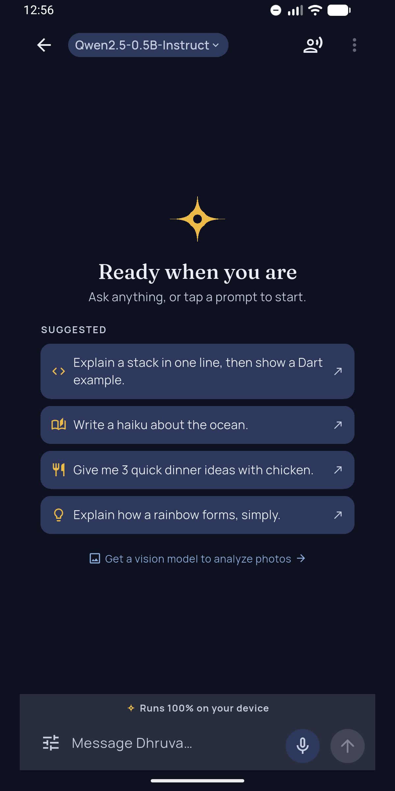
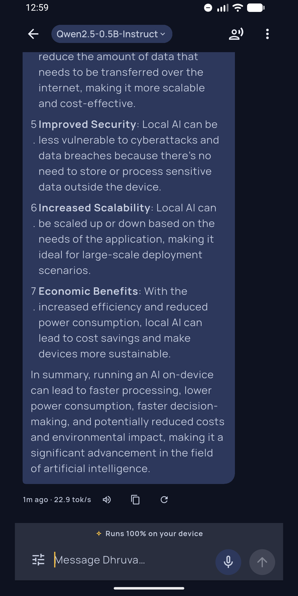
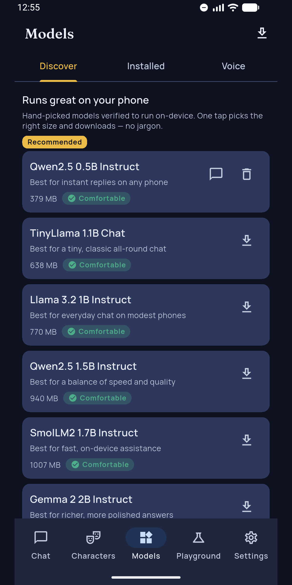
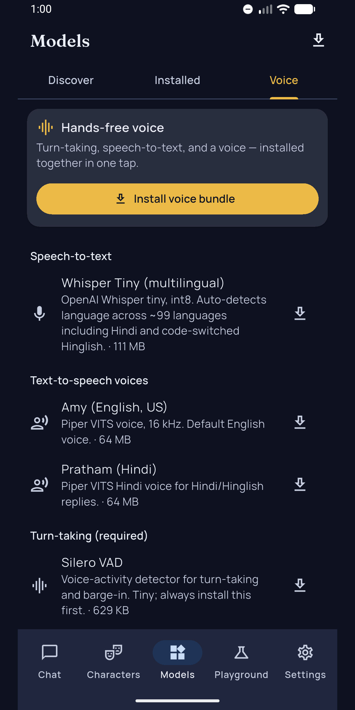
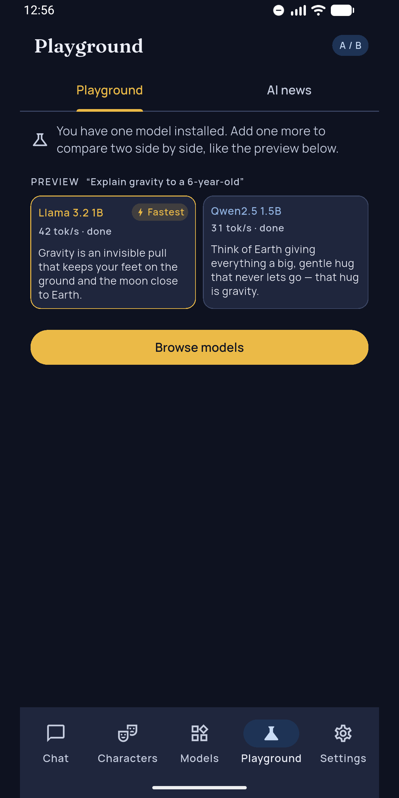

# Dhruva AI

**Your AI. Your phone. Nobody else's business.**

Open-source app that runs large language models **entirely on your phone**. No server, no account, no telemetry. Download a model once, switch on airplane mode, and keep going.

[](https://github.com/AnshRajput/dhruva-app/actions)
[](LICENSE)
[](CONTRIBUTING.md)

<a href="https://play.google.com/store/apps/details?id=app.dhruva.mobile">Get it on Google Play</a> · iOS: TestFlight / App Store (rolling out)

<p>
  
  
  
  
  
</p>

## Why it exists

Every cloud chatbot sees what you type. That's fine for trivia and wrong for a medical report, a salary slip, a legal notice or a private message you're trying to word carefully. Dhruva is built for exactly those moments: the model runs on your phone's CPU/GPU through [llama.cpp](https://github.com/ggml-org/llama.cpp), and the only network request the app ever makes is the model download you start yourself.

ध्रुव (Dhruva) is the pole star, the one fixed point in the night sky. Same idea: always there, needs no network, yours alone.

## What you can do with it

**One-tap workflows** for the things small on-device models are genuinely good at. Paste text, open a file, or share it from any app, then tap:

| | | |
|---|---|---|
| Summarize | Key points | Explain simply |
| Translate (English, Hindi, Hinglish, …) | Rewrite (formal, friendly, shorter, …) | Fix grammar |
| Draft a reply | Extract to-dos | Study notes |
| Quiz me | Social caption | Understand a document |

**Works from anywhere on Android:** select text in any app → **Ask Dhruva AI**, or share text to Dhruva, or long-press the icon for *New chat* / *Workflows* shortcuts.

**And the full toolkit:**

- **Offline chat** with streaming replies, plus visible reasoning for thinking models (collapsible, not dumped into the answer).
- **Any GGUF model.** Use the curated catalog (each model labelled with size and whether your phone can run it comfortably), search all of Hugging Face, or **import a `.gguf` file** you already have.
- **Characters**: personas with their own system prompts and separate histories.
- **Voice, both directions.** Whisper speech-to-text (Hindi and Hinglish included) and Piper text-to-speech, hands-free mode with voice-activity detection.
- **Vision**: ask questions about a photo or screenshot with an on-device vision model.
- **Playground**: same prompt, two models, side by side, with speed.
- **Search every chat**, export chats as Markdown/JSON.
- **Safety you can see**: report any reply in one tap (stored on your phone; email it to us only if you choose), with conservative on-device guardrails against clearly harmful requests.

## Privacy, concretely

- All inference happens on the device. There is no cloud path, and no fallback.
- No analytics, crash reporters, ads or tracking SDKs. No account.
- Network use: Hugging Face model browsing/downloads you initiate. That's it.
- Apache-2.0 and fully open source, so every line above is auditable, not just asserted. iOS ships a privacy manifest declaring zero collected data.

## Under the hood

The parts worth reading if you build on-device AI:

- **Engine**: `llama_cpp_dart` pinned to an exact commit, behind an abstract `EngineService`. Inference runs on a worker isolate, never the UI thread; load/dispose are idempotent and survive double-load, dispose-twice and mid-stream cancellation.
- **KV-cache prefix reuse** across chat turns: instead of re-prefilling the whole conversation each turn (O(n²) as chats grow), Dhruva diffs the prompt against the cached prefix and only decodes the new suffix. Measured on SmolLM2: ~118 → ~17 prompt tokens per warm turn, **~6.9× faster turns**. Context-shift trims long chats instead of failing.
- **Flash attention + q8_0 KV cache** knobs (KV memory 5.62 → 2.99 MiB at the same context).
- **iOS**: Metal-enabled `llama.xcframework` vendored and wired into CocoaPods by hand (it isn't a Flutter plugin); ~65 tok/s measured on Apple Silicon.
- **Android**: arm64 llama.cpp rebuilt from source with **16 KB page alignment** for Android 15+ devices ([`scripts/build-android-aar.sh`](scripts/build-android-aar.sh)), verified by a real load-and-generate integration test.
- **Downloads** that survive backgrounding (foreground data-sync service), resume with HTTP Range, and sha256-verify against Hugging Face's LFS hash before a model is ever registered.
- **Tests**: ~900 unit/widget tests including a hostile corpus (corrupt GGUFs, paste bombs, RTL/emoji, double-load, dispose-twice), plus on-device engine proofs for Android and iOS.

Architecture is feature-first (`lib/features/*` never import each other), Riverpod for state, Drift for storage, go_router for navigation, and every color/text style flows from [`design-tokens.json`](design-tokens.json). Details: [docs/architecture.md](docs/architecture.md).

## Runs on

- **Android** 8.0+ (arm64) · **iOS** 14.0+
- Rough RAM guide: ~1B params → 4 GB · 3–4B → 6 GB · 7B+ → 8 GB. Small models (0.5–1.5B) are fast on most modern phones and great at the workflows above.

## Build from source

```bash
cd app
flutter pub get
make verify   # analyze + format check + tests
flutter run
```

Native engine binaries: Android `app/android/app/libs/llama-cpp-dart.aar` (rebuild: `scripts/build-android-aar.sh`), iOS `app/ios/Vendor/llama_cpp` (`scripts/fetch-ios-xcframework.sh`). See [CONTRIBUTING.md](CONTRIBUTING.md) and [docs/development.md](docs/development.md).

## Roadmap

Next up: chat with PDFs (on-device retrieval), iOS share extension, an on-device benchmark that labels every model with *your* phone's real tokens/sec, and Android GPU offload. See [docs/roadmap.md](docs/roadmap.md).

## Contributing

Code, model catalog entries, translations and bug reports are all welcome. Ground rules: privacy is non-negotiable (no telemetry, no cloud fallback, ever), `make verify` must pass, small conventional commits. See [CONTRIBUTING.md](CONTRIBUTING.md).

## License

Apache License 2.0. See [LICENSE](LICENSE).

---

Built by **Appu Inside Engineering** ([Ansh Gandharva](https://anshgandharva.in)). Building on-device AI into your product? Get in touch.

*Not affiliated with AI4Bharat's Dhruva speech platform.*
