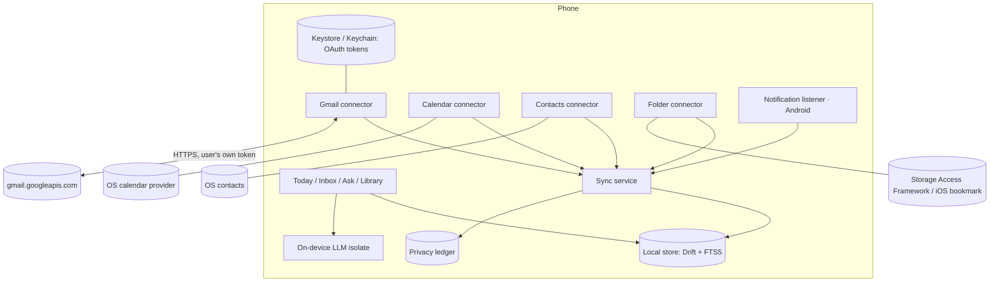
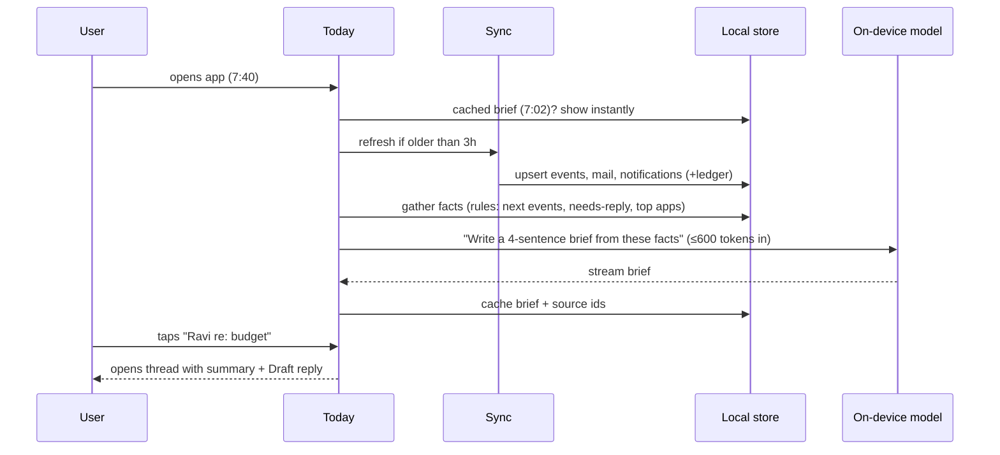
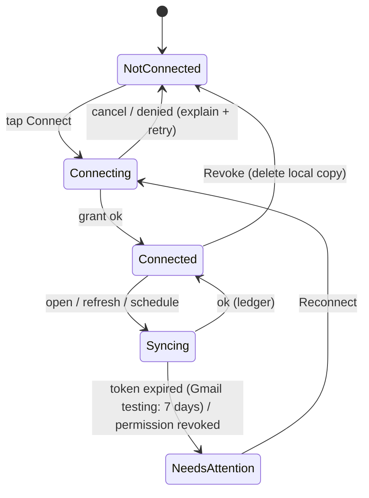

# Spec: private daily assistant (0.7)

## 1. Information architecture

```mermaid
flowchart LR
  subgraph Tabs
    T[Today]:::tab --- I[Inbox]:::tab --- A[Ask]:::tab --- L[Library]:::tab
  end
  T -->|gear| S[Settings]
  S --> C[Connectors + privacy ledger]
  S --> M[Models: discover / installed / voice / speed test / compare]
  S --> P[About me · Appearance · Notifications · Safety · Crash reports · About]
  A --> PER[Personas (was Characters)]
  A --> ACT[Actions (was Workflows)]
  A --> HF[Hands-free voice]
  classDef tab fill:#0E1220,stroke:#EBBA47,color:#fff
```

Where today's 5 tabs go (no capability dropped — parity matrix rows in brackets):

| Today (0.6.1) | 0.7 home | Notes |
|---|---|---|
| Chat tab [4–22] | **Ask** tab | Conversation list becomes Ask's history; folders, pins, search kept |
| Workflows (icon) [27–31] | **Actions**, inside Ask + one-tap row on Today | Renamed "Actions"; same 12 verbs; take input from mail/files too |
| Characters tab [32–35] | **Personas**, inside Ask (chip in composer + gallery) | Seed 3–5 built-ins (fixes D8) |
| Models tab [36–40] | Settings → Models | Onboarding picks by RAM; speed test labels; Downloads stays reachable from a status pill when active |
| Playground tab [41–42] | Settings → Models → Compare; AI news under Models | Real measured numbers only (fixes D4) |
| Settings tab [43–49] | Gear on Today header | Gains real preferences (theme, about me, notifications) |

## 2. Surfaces

### 2.1 Today (default landing)
- **Header:** greeting + date + weather-free (no network) day summary line; gear; status pill when a model is warming up or a download runs.
- **Brief card:** 3–5 sentences written on-device: first event, who you meet, mail that needs a reply, notable notifications. Each sentence is tappable and opens its source. "Updated 7:02 · on this phone".
- **Up next:** next 2 events (time, title, attendees with avatars from Contacts → tap = meeting prep: last emails with that person, notes mentioning them).
- **Needs you:** up to 3 mail threads flagged needs-reply, each with one-line summary + "Draft reply".
- **Notifications digest (Android):** grouped by app, one line each, "Clear" marks read.
- **Quick actions row:** Summarize clipboard · Draft reply · Plan my day · Ask my files.
- **Empty states teach the next step:** no connectors → "Connect your calendar (no sign-in needed)" one-tap; no model → one-tap recommended download with size.
- Brief is generated deterministically from data + a fixed prompt; cached; regenerated on open if older than 3 h, on pull-to-refresh, and by an optional morning notification at a user-chosen time.

### 2.2 Inbox
- One list, sections: **Needs reply** · **Today** · **Earlier**; source filter chips (All · Mail · Notifications).
- Row: sender identity (contact photo or initial), subject/app, one-line summary (generated lazily for visible rows, cached), time.
- Thread view: summary at top, original below (collapsed quoted text), actions: **Draft reply** (tone chips: Short · Warm · Formal; editable; **Save as Gmail draft** or **Open in Gmail**; never auto-send), **Add to calendar** (when a date is detected; confirm sheet), **Ask about this**.
- Priority = rules first (contact known, direct-to-me, Gmail IMPORTANT label, question mark/"?" in body), model only breaks ties with a yes/no prompt.

### 2.3 Ask
- Composer with **Sources** chips: Mail · Calendar · Contacts · Files · Docs (attached) · None. Default "Auto" picks sources by keywords ("email", "meeting", a contact name, "file"); user can pin.
- Answers grounded in sources show **Sources** chips under the reply (open the email/event/file/page). Ungrounded answers say so.
- Persona chip, model chip, mic (hold-to-talk), hands-free, attach (image for vision models, document for doc chat), Actions sheet.
- History list = today's conversation list (folders, pins, search, export kept).
- Fixes: D1 (stopped/truncated marker + **Continue**), D2 (load-failure copy + Try again / smaller model / re-download last), D3 (composer clears on send; "warming up model · 4s" phase; timeout recovery).

### 2.4 Library
- **Folder** (connected via system folder picker): file list, index status ("312 files · indexed while charging"), search.
- **Documents** attached to chats (from doc-chat feature).
- **Saved**: answers/drafts the user saved; **To-dos** extracted by the "Extract to-dos" action, with check-off.

### 2.5 Settings
- **Connectors**: each card shows state (Not connected / Connected · last sync / Needs attention), what it can read, Revoke & delete local copy. **Privacy ledger**: chronological "Read 23 emails from Gmail · 7:01" entries; header fact "0 bytes sent to any Dhruva server — there isn't one".
- **About me**: name, role, writing tone, signature — injected into drafts and answers (fixes G6 lite).
- **Appearance**: System / Light / Dark (fixes D13), text size follows OS.
- **Models**: existing hub + speed test labels + compare + voice + AI news.
- **Notifications**: morning brief time (off by default), download notices.
- Safety & reports, Crash reports, About (version first, manifesto last — D9).

### 2.6 Platform chrome (CLAUDE.md Rule 6)
- Android: Material 3 Expressive — pill nav indicator, stadium buttons/chips, via theme shape tokens.
- iOS: Cupertino-feel chrome; translucent tab/nav bars approximated with `BackdropFilter` (chrome only, never content) with a reduce-transparency fallback; named as an approximation in code.
- Brand colors, type (Fraunces display / Manrope UI), spacing identical across platforms. Follow system light/dark.

## 3. Connector architecture



- **Interface** (`data/connectors/`): `Connector { id, displayName, Status status, Future<void> connect(), Future<SyncResult> sync({since}), Future<void> revoke() }` — one implementation each; no plugin system (YAGNI).
- **Store**: Drift schema bump (after doc-chat's v6 → **v7**): `connector_accounts`, `items` (source, externalId, kind mail/event/contact/file/notification, title, body (capped), people json, startsAt/sentAt, flags json, summary, summaryModel), `items_fts` (FTS5 over title/body/summary), `ledger` (connector, action, count, at). Retrieval for Ask and doc chat converges on SQLite FTS5 BM25 (`bm25()`), replacing the Dart BM25 in the doc-chat PR once both land (one ranking path).
- **Gmail**: `google_sign_in` 7.x + `googleapis` gmail v1. Scopes: `gmail.readonly` (read) and `gmail.compose` (create drafts). Fetch last 7 days / 200 threads by default, metadata + plain-text body capped at 8 KB/message. Tokens only in the OS keystore (`flutter_secure_storage`). Testing mode until Google verification (needs privacy policy on our domain + demo video).
- **Calendar / Contacts**: `device_calendar_plus` (MIT) and `flutter_contacts` (MIT); read-only; iOS 17 full-access calendar string; Contacts read limited to people appearing in events/mail (Play's 2027 contact-picker policy: we qualify as core functionality, but keep reads minimal).
- **Folder**: native channel — Android SAF `ACTION_OPEN_DOCUMENT_TREE` + persistable permission; iOS security-scoped bookmark. Index .txt/.md/.pdf (PDF via the doc-chat extractor), size caps, index only while charging or on demand.
- **Notifications (Android only)**: `NotificationListenerService` (Kotlin) writing title/text/app/time into the store; user picks excluded apps; OTP/sensitive notifications are already redacted by Android 15; nothing on iOS (the card is hidden there).
- **Sync**: on app open + pull-to-refresh; Android WorkManager periodic (6 h, requires charging or battery-not-low); iOS background fetch best-effort. Every sync writes ledger rows.
- **Revoke**: deletes tokens, local items, FTS rows for that connector; ledger keeps the revoke entry.

## 4. Key flows





Draft reply: Inbox thread → Draft reply → tone chip → model streams draft using About me + last 2 messages → user edits → **Save as Gmail draft** (`gmail.compose`) or **Copy / Open in Gmail**. Never send.

## 5. Onboarding (first value < 60 s)
1. Welcome (one line, what it does, privacy fact).
2. Pick model (RAM-based recommendation, size, speed label after download) — download starts in background.
3. Connect calendar (system permission, no account) → optional Gmail, folder, notifications ("you can do this later").
4. Today renders immediately with real events; brief appears when the model is ready.

## 6. Out of scope for 0.7 (parked, with revival condition)
- Sending mail / writing calendar events directly (revive after drafts prove trustworthy; needs `gmail.send`).
- Embeddings / vector search (revive if FTS5 recall is measurably poor on real data).
- Outlook/IMAP connectors (revive on user demand; IMAP needs app-password UX).
- Tool-calling reminders/alarms (revive with a 3B+ model that follows JSON reliably).
- Backup/sync across devices (G9) and cloud escape hatch (G16): cut — conflicts with the privacy position.

## 7. Verification plan
- Unit/widget tests per connector with fakes; migration v5→v6→v7 tests; FTS ranking tests.
- Integration test on emulator: calendar seeded via `adb shell content insert`, notifications posted via `adb shell cmd notification post`, folder with fixture files; Gmail with a test account in OAuth testing mode.
- Live re-audit with the same rubric; target ≥ 34/40 and the day walk re-run.
- Security review (CLAUDE.md Rule 7) on: token storage, exported components (tile/widget/listener), folder path handling, intent extras.
- Release gate: emil-design-eng + apple-design review table, `review-animations` (owner-run), `flutter analyze` 0, tests green, on-device verification on Android emulator + iOS simulator.

## 8. Revision 1 — answers to the adversarial doc review (`doc-review.md`, 45 findings)

**Blockers**
- **B1 Backup leak (#1).** Set `android:allowBackup="false"` and `android:fullBackupContent="false"` / `dataExtractionRules` excluding everything; iOS: exclude the DB, folder index and tokens from iCloud backup (`NSURLIsExcludedFromBackupKey`). Ships in the first phase, before any connector stores data. Existing chats are covered too.
- **B2 Empty tabs (#31).** Phasing changes: the **device connectors (calendar, contacts, folder, notifications) ship together with the new shell** (0.7a). Gmail stays 0.7b. The **Inbox tab is shown only when at least one inbox source is connected** (Gmail, or notifications on Android); until then Today carries one "Set up your inbox" card. iOS without Gmail therefore never sees an empty Inbox. Library always has Documents + Saved + To-dos, so it is never empty; the folder block is an inline "Connect a folder" row.

**Corrections**
- **Network, stated exactly (#2, #4).** The app makes these network calls, all user-visible and listed in Settings → Privacy: model downloads (Hugging Face, user-initiated), AI news (opt-in), app-update checks (Shorebird: app version + patch number only), and the user's own providers once connected (Gmail API). No Dhruva server exists. New pub packages are listed in the release notes and each is reviewed for network use (none may phone home).
- **Gmail scopes (#7).** `gmail.readonly` **and** `gmail.compose` are both *restricted* scopes → Google verification required for both; CASA only applies if data is stored/transmitted on servers (it is not). To shrink review risk, 0.7b ships **read-only first**; "Save as Gmail draft" is enabled only after verification passes; until then drafts go via Copy / Open in Gmail (share intent).
- **Tokens (#8).** `google_sign_in` 7.x manages its own credential storage via the OS (Credential Manager / Keychain); we do not persist access tokens ourselves. Background sync uses `authorizationClient.authorizationForScopes` silently; if it needs user interaction, the connector goes to *Needs attention* — no background prompts.
- **Search (#10).** Drift 2.34.2 has no first-class FTS5 support (documented in `chat_repository.dart`). Plan: probe FTS5 availability at runtime with raw SQL (`CREATE VIRTUAL TABLE ... USING fts5`); use it if present, otherwise fall back to the doc-chat PR's Dart BM25 over a SQL `LIKE`-prefiltered candidate set (cap 2,000 rows). One `SearchIndex` interface, two implementations, chosen once at startup.
- **Schema numbers (#11).** Migrations are numbered at merge time, not in this doc: doc-chat takes the next version when it merges; connectors take the one after.
- **Deep links (#9).** There is no VIEW intent filter today; pre-mortem #9 is corrected to "in-app routes `/chat/:id` keep working; external deep links do not exist and are not added".
- **Add to calendar (#26).** Calendar stays read-only. "Add to calendar" opens the **OS insert-event screen prefilled** (Android `Intent.ACTION_INSERT` on `CalendarContract.Events`, iOS `EKEventEditViewController`) — the user saves it there; no write permission needed.
- **Brief citations (#27).** The model writes from a numbered fact list and must keep `[n]` markers; the UI turns markers into tap targets and drops any sentence without a valid marker. The fact list is always visible under "How this was written".
- **<60 s promise (#23).** Reworded: real events on Today in under 60 s (calendar needs no model); the written brief appears when the model is ready (download in progress is shown with time left).
- **Lazy summaries vs battery (#24).** Summaries run only for rows on screen when the app is open, plus a batch while charging. Never in the background on battery.
- **Kill switch (#25).** A Shorebird patch can hide the digest UI but cannot remove the native listener; the listener is only enabled after the user grants access, and can be removed only by a store update — pre-mortem #3 corrected.
- **Walk counts (#12).** Re-counted from the audit tags: baseline is 5 leave / 9 guess / 4 retype / 7 none (brief updated).

**Privacy & security additions (#3, #5, #6, #36, #37)**
- Mail, notification and file text is **untrusted input**: it is only ever placed inside a delimited "sources" block in prompts; model output can never trigger an action by itself (every action is a user tap on a button we render).
- Exports, reports and crash logs never include connector content unless the user explicitly adds it; crash logs strip message bodies.
- Widget shows no mail/notification content (counts and next event title only, with a setting to hide titles); tile opens the app normally (lock screen requires unlock); optional "Hide content in app switcher" (FLAG_SECURE / iOS snapshot blur); notification digest is off by default.
- The Kotlin listener writes to its own small append-only file queue; Dart ingests it on open — no concurrent writers to the Drift DB.
- Revoke = Google `disconnect()` (revokes the grant) + delete local data + a deep link to the OS permission page for calendar/contacts/notification access (apps cannot revoke OS grants themselves).

**Homes for every parity row (#14–17)**
| Parity rows | 0.7 home |
|---|---|
| 1–3 onboarding | Onboarding v2 (welcome → model → connect calendar → Today); download-error recovery kept verbatim |
| 15 per-chat system prompt + sampling | Ask thread → "Chat settings" sheet (plain labels: Creativity, Answer length; Top-P/Top-K under Advanced) |
| 10–14, 18 per-reply + per-chat actions | unchanged under replies / thread menu |
| 29–31 share sheet, text selection, shortcuts | still land in **Actions** (Ask) prefilled; shortcuts gain "Today" and "Ask" |
| 32–35 personas create/edit/import/export | Ask → Personas gallery (same screens, renamed) |
| 41–42 compare, AI news | Settings → Models → Compare / AI news |
| 50–52 snackbars, failure mapping, safety guard | unchanged, plus the D2/D3 copy fixes |

**Audit coverage (#20, #21)** — D5 human model names; D6 jargon behind Advanced; D7 labelled entry points; D10 Today replaces the empty home; D11/D12 Installed row layout + Recommended pill rules; D14 all out-of-shell `/models` pushes go through `/models/hub` (sweep); D15 Open-settings deep link + onboarding nudge; **D16 background generation**: brief/summaries run only in foreground or charging batches; chat generation gets a "keeps going while you're away" foreground service on Android (parked for iOS). G2 (date/time/battery awareness — cheap, in), G7 (to-dos in Library — in), G8 (Copy/share a single reply + Open in Gmail — in; in-place PROCESS_TEXT replacement — in, Android returns result to the source app), G11 (as D16), G12 (saved prompts → "My actions", parked to 0.8), G13 (per-task model auto-pick — parked), G15 ("What can I ask?" tips on empty Ask — in).

**Missing states (#32–35)** — every surface gets: loading (skeleton, not spinner), offline ("Showing what's on this phone · last synced 7:01"), error (names the fix: "Calendar access is off → Open settings"), empty (teaches next step), permission-denied (Open settings button). Ask source chips for unconnected sources show "Connect" inline instead of silently doing nothing. Notification digest rows open the source app's notification intent when available, else the app.
